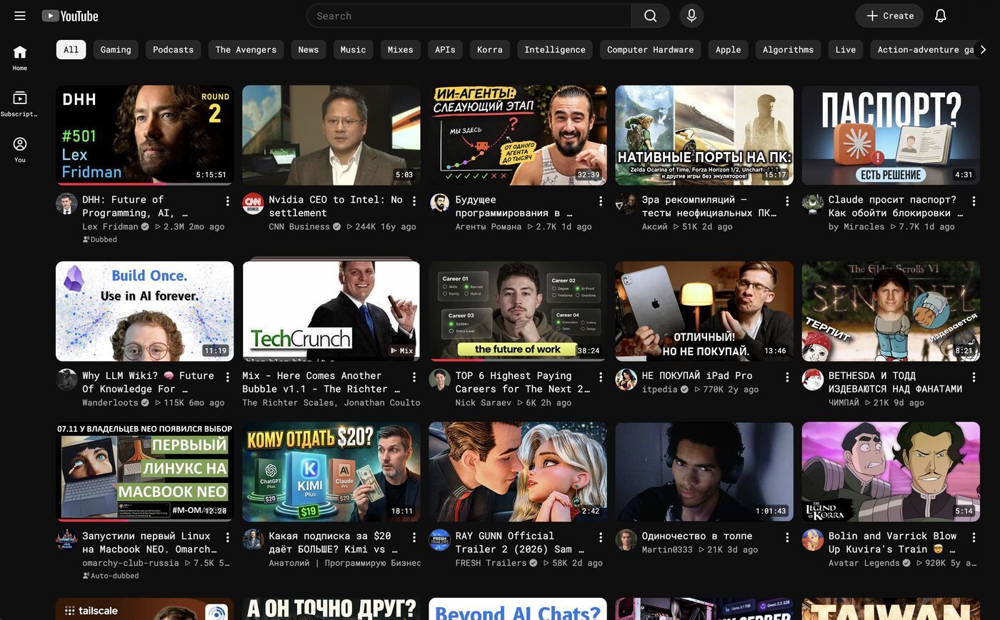
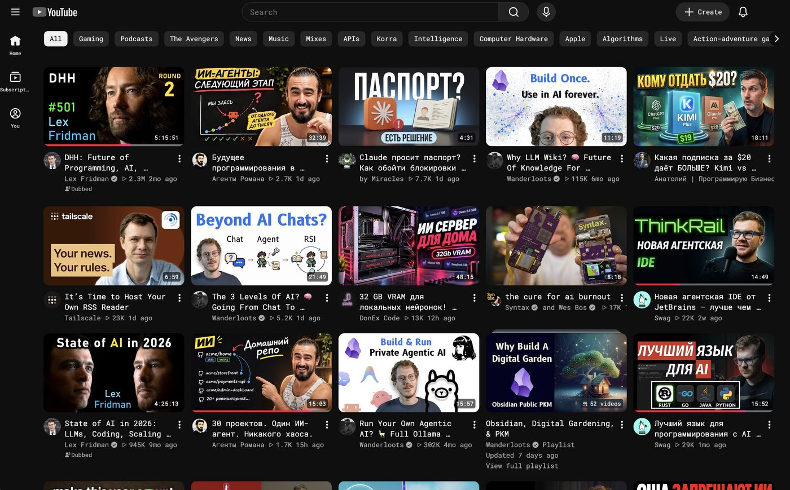
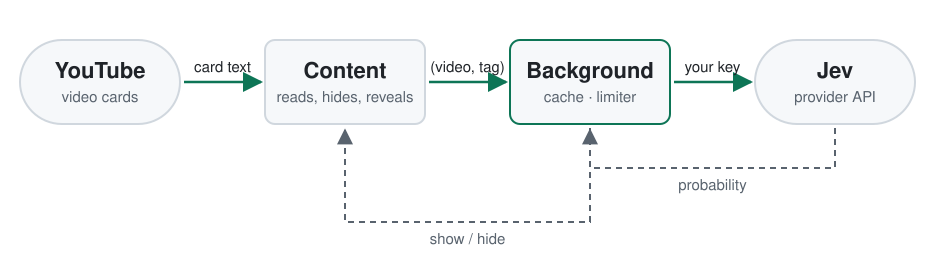

<p align="center"></p>

<h1 align="center">slop-block</h1>

<p align="center"><b>Take back your YouTube feed: describe what you want to watch, and an AI decision model hides the rest.</b></p>

<p align="center">
slop-block is a Chrome extension that filters YouTube by tags you write in plain language.<br>
Each video is judged by TypeSafe Jev through your own API key. No backend, no account, no analytics.
</p>

<p align="center">
  <a href="https://github.com/alexzomai/slop-block/releases/latest"></a>
  
  
  
  <a href="LICENSE"></a>
</p>

<p align="center">
  <a href="#why">Why</a> ·
  <a href="#features">Features</a> ·
  <a href="#how-it-works">How it works</a> ·
  <a href="#install">Install</a> ·
  <a href="#quick-start">Quick start</a> ·
  <a href="#settings">Settings</a> ·
  <a href="#privacy">Privacy</a> ·
  <a href="#faq">FAQ</a> ·
  <a href="#development">Development</a>
</p>

---

## Why

The YouTube home feed is tuned for watch time, not for what you actually care about. Blocking channels one by one does not scale, and keyword filters miss everything phrased differently.

slop-block lets you say what you want ("programming tutorials", "calm travel documentaries") or what you don't ("celebrity gossip"). For every video card, a decision model answers whether the card matches your tags, and the feed follows.

## Without filter / With filter

The same YouTube home feed, before and after. The tags were about IT, AI and software, in **Show only matching** mode.

<table>
  <tr>
    <th align="center">Without filter</th>
    <th align="center">With filter</th>
  </tr>
  <tr>
    <td></td>
    <td></td>
  </tr>
</table>

## Features

- **Smart tags.** Up to 20 tags of up to 200 characters, written as plain statements. A video that matches any enabled tag counts as matched.
- **Two modes.** **Show only matching** (allowlist, default) keeps only matching videos; **Hide matching** (blocklist) hides what matches.
- **Decisions by TypeSafe Jev.** The `typesafe/jev-1.13` model runs through [OpenRouter](https://openrouter.ai) (default) or the native [TypeSafe](https://docs.typesafe.ai) API, with your own key for the provider you select.
- **Feed autofill.** In **Show only matching** mode the extension keeps loading further portions of the feed until the number of matching videos you set (6–30, default 12) is on screen, with cost limits: it stops after 5 empty portions in a row or 15 portions per page visit.
- **Status indicator.** A block at the bottom of the feed shows whether it is searching (with progress), done, stopped (with the reason and a **Search more** button), at the end of the feed, or unable to filter (with a **Settings** button).
- **Ads.** In **Show only matching** mode, ad slots in the feed are hidden and never sent to the provider; in **Hide matching** mode they are left alone.
- **uBlock Origin Lite compatibility.** An optional toggle for pages where the ad blocker also hides cards. In **Hide matching** mode, undecided cards hidden by someone else's CSS are not counted and not evaluated, so no paid call is spent on them until they become visible. In **Show only matching** mode the extension cannot tell the ad blocker's hiding from its own, so such cards are still evaluated; only id-less placeholder shells are left out of the count.
- **Subscriptions and search.** The Subscriptions page is left unfiltered by default (**Don't filter subscriptions**); search results are unfiltered unless you turn on **Filter search results**.
- **Cheap by design.** A decision for a (video, tag) pair is cached for up to 30 days (capacity 20,000 pairs, oldest evicted first), and concurrent requests for the same pair share one call. On real usage this is on the order of $0.000016 per video, roughly $0.016 per 1,000 videos; the figure is approximate and depends on title length and tag count.
- **Spend block.** The popup shows OpenRouter spend (today, total, remaining limit). TypeSafe has no balance API, so for it the popup shows local request and token counts and a labelled cost estimate.
- **Fail-open.** No key, network error, rate limit or a bad response never breaks the page; in Hide mode nothing is hidden by mistake.
- **English and Russian interface.**

## How it works

<picture>
  <source media="(prefers-color-scheme: dark)" srcset="docs/diagrams/how-it-works-dark.svg">
  
</picture>

Jev is a decision model that answers yes/no questions. For each video card the extension sends the title, the channel and a short description snippet together with your tags, and Jev returns how likely each tag matches. If the probability passes your threshold (default `0.7`), the video is matched. In **Show only matching** mode matched videos fade in and the rest stay hidden; in **Hide matching** mode matched videos are hidden.

| Part | What it does | Where it runs |
| --- | --- | --- |
| Content script | Finds video cards, reads their text, shows or hides them, autofills the feed, draws the status block. | youtube.com page |
| Background service worker | Holds the API key and talks to the provider. Keeps the decision cache, a single request limiter and a deadline on every request, and counts spend. | Extension |
| Popup and options | Tags, mode, toggles, spend; provider, keys, models, threshold. | Extension pages |
| Jev | Scores each (video, tag) pair. | OpenRouter or TypeSafe |

## Install

From a release (no build needed):

1. Download the latest zip from [Releases](https://github.com/alexzomai/slop-block/releases/latest) and unpack it.
2. Open `chrome://extensions` and enable **Developer mode**.
3. Click **Load unpacked** and pick the unpacked folder.

Or build it yourself:

```sh
npm ci && npm run build
```

Then load the `dist/` folder with **Load unpacked** as above.

Requires Chrome 120 or newer.

## Quick start

1. Create an API key at [openrouter.ai/keys](https://openrouter.ai/keys) (add a small credit balance; a spending limit on the key is a good idea) **or** at [console.typesafe.ai/keys](https://console.typesafe.ai/keys) for the native TypeSafe API.
2. Open the extension options (popup → *Settings*), choose the **Decision provider**, and paste the key into the section of that provider. The page only shows that a key is saved.
3. Open the popup, choose a mode and add tags.
4. Open YouTube.

Write tags as **direct statements**, not negations. Good: "productivity tips", "programming tutorials", "calm travel documentaries". Avoid: "not clickbait", "no celebrity gossip". To exclude something, switch to **Hide matching** and describe it directly: "celebrity gossip".

## Settings

| Setting | Where | Default | Meaning |
| --- | --- | --- | --- |
| Filter enabled | Popup | on | Turns the filter on or off. |
| Mode | Popup | Show only matching | **Show only matching** or **Hide matching**. |
| Don't filter subscriptions | Popup | on | Leaves the Subscriptions page unfiltered (and free). |
| Filter search results | Popup | off | Applies the filter to search results too. |
| Compatibility with uBlock Origin Lite | Popup | off | For ad-blocker-hidden cards: saves paid calls in **Hide matching** mode only (see Features). |
| How many videos to keep on screen | Popup | 12 (range 6–30) | Target for feed autofill. |
| Decision provider | Options | OpenRouter | OpenRouter or TypeSafe. |
| Model | Options | `typesafe/jev-1.13` (OpenRouter), `jev-1.13.0` (TypeSafe) | The same Jev version, so decisions share the cache. |
| Threshold | Options | `0.7` (range 0–1) | Lower matches more. |

Autofill works in **Show only matching** mode only; it is off in **Hide matching** mode, on the Subscriptions page when **Don't filter subscriptions** is on, and when no key is set. If loading more cannot be triggered safely on a page, the indicator shows "Scroll down to load more".

## Privacy

- Sent to the provider you selected: only the video **title**, **channel** and a short **description snippet**, plus your tag texts. Nothing else from the page, no browsing history, no account data.
- Your API key stays on your machine in `chrome.storage.local`, which is available only to the extension's trusted contexts (not to content scripts or YouTube pages). Each provider's key is sent only to that provider, as the authorization header.
- There is no slop-block server. Tags and settings sync via your browser's own extension storage.
- Page text is read and written as plain text only (`textContent`).
- Permissions: `storage`, plus host access to youtube.com, openrouter.ai and api.typesafe.ai. No remote code.

## FAQ

<details><summary><b>Why do I need my own API key?</b></summary>

There is no slop-block backend, so requests go from your browser straight to OpenRouter or TypeSafe and are billed to your own account there. You control the spending, for example with a limit on the key.
</details>

<details><summary><b>Does it work on Subscriptions and search?</b></summary>

By default the Subscriptions page and search results are left alone. Turn off **Don't filter subscriptions** or turn on **Filter search results** in the popup to filter them as well.
</details>

<details><summary><b>What happens if the API is down or my key is wrong?</b></summary>

The extension fails open, so the page stays usable. With no key or a rejected key, the feed is shown unfiltered right away. On a network error or rate limit it retries a few times; in **Show only matching** mode a card stays hidden until the retries run out, and only then is shown without a decision. The status block at the bottom of the feed says that the filter is not working and offers **Settings**.
</details>

<details><summary><b>Will I pay again for videos I have already seen?</b></summary>

Not while the decision is cached: it is stored per (video, tag) pair for up to 30 days. A tag with different wording is a different tag and is evaluated again; letter case does not matter.
</details>

<details><summary><b>Why does my feed look half empty or keep loading?</b></summary>

Hidden videos leave gaps, so in **Show only matching** mode the extension loads more of the feed until your target is reached. It gives up after 5 empty portions in a row or 15 portions per page visit and says why; **Search more** or a scroll resumes it.
</details>

<details><summary><b>Does it work with uBlock Origin Lite?</b></summary>

Yes. In **Hide matching** mode, turn on **Compatibility with uBlock Origin Lite** in the popup so that undecided cards hidden by the ad blocker are not evaluated and do not cost a paid call. In **Show only matching** mode the toggle does not save calls, because the extension cannot tell the ad blocker's hiding from its own.
</details>

## Development

```sh
npm ci
npm run typecheck
npm run lint
npm test               # vitest, no browser needed
npm run build          # -> dist/
npm run build:test     # -> dist-test/ (stub background)
npm run e2e            # Playwright, needs system Chromium (CHROMIUM_PATH)
npm run screenshots    # refresh docs/screenshots (needs Chromium)
```

See [AGENTS.md](AGENTS.md) for the architecture and invariants.

```text
src/background/   service worker: provider clients, limiter, cache, spend
src/content/      youtube.com: card detection, filter loop, autofill, indicator
src/popup/        popup UI
src/options/      options page (provider, keys, models, threshold)
src/shared/       settings and the message contract between contexts
static/           manifest, HTML, CSS, locales (en, ru)
tests/  e2e/      vitest unit tests; Playwright against a YouTube fixture
```

## License

[MIT](LICENSE). The bundled JetBrains Mono font stays under the SIL OFL (see `static/fonts/OFL.txt`).
