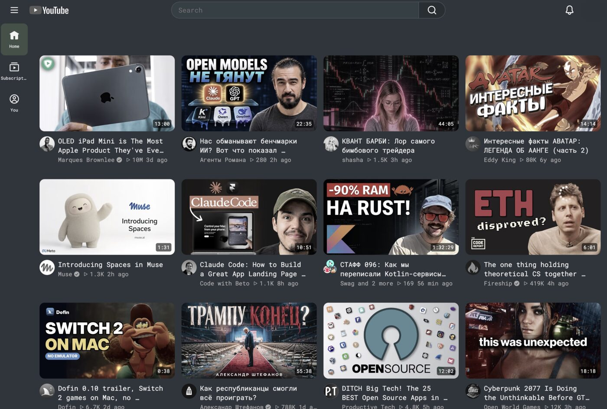
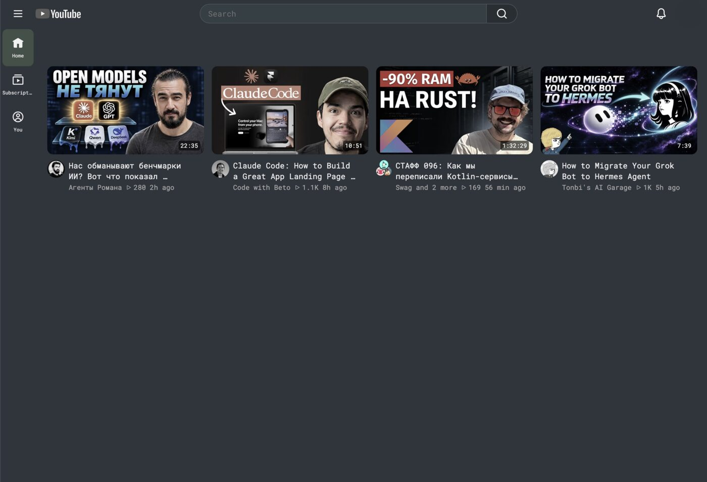

<p align="center"></p>

# slop-block

**Take back your YouTube feed: describe what you want to watch, and an AI decision model hides the rest.**

## Features

- Filter the YouTube feed with plain-language tags such as "productivity tips" or "programming tutorials".
- Two modes: **Show only matching** (everything else is hidden) or **Hide matching** (hide what you don't want).
- Decisions by [TypeSafe Jev](https://openrouter.ai/typesafe/jev-1.13), using **your own API key** from either provider: [OpenRouter](https://openrouter.ai) (default) or [TypeSafe](https://docs.typesafe.ai) directly.
- Cheap: a decision for a (video, tag) pair is reused while it stays in the cache (up to 30 days, capacity 20,000 pairs, oldest evicted first); simultaneous requests for the same pair are paid for once.
- Built-in spending block in the popup (OpenRouter: today, total, remaining limit; TypeSafe has no balance API, so it shows local request/token counts and a labelled cost estimate).
- Option to leave your subscriptions page untouched.
- English and Russian interface.
- No backend, no account, no analytics.

## Without filter / With filter

The same YouTube home feed, before and after. The tag was about IT, AI and software, in **Show only matching** mode.

<table>
  <tr>
    <th align="center">Without filter</th>
    <th align="center">With filter</th>
  </tr>
  <tr>
    <td></td>
    <td></td>
  </tr>
  <tr>
    <td align="center">12 videos, mostly unrelated</td>
    <td align="center">4 videos that match the tag</td>
  </tr>
</table>

## How it works

Jev is a decision model that answers yes/no questions. For each video card the extension sends the title, the channel and a short description snippet together with your tags, and Jev says how likely each tag matches. If the probability passes your threshold (default 0.7), the video is matched. In **Show only matching** mode matched videos fade in and the rest stay hidden; in **Hide matching** mode matched videos are hidden.

Every decision is cached by the pair (video, tag) for up to 30 days (capacity 20,000 pairs, oldest entries are evicted), so scrolling back, reloading or reopening YouTube normally costs nothing for pairs already cached. If anything goes wrong (no key, network error, rate limit), the extension fails open and the page keeps working.

**Cost.** On real usage it is on the order of **$0.000016 per video**, roughly **$0.016 per 1,000 videos** (approximate, depends on title length and your tag count).

## Install

1. Build it: `npm ci && npm run build`
2. Open `chrome://extensions`, enable **Developer mode**, click **Load unpacked** and pick the `dist/` folder.

A packaged zip will be linked here once releases exist: _release link: coming soon_.

Requires Chrome 120 or newer.

## Setup

1. Create an API key at [openrouter.ai/keys](https://openrouter.ai/keys) (add a small credit balance; a spending limit on the key is a good idea) **or** at [console.typesafe.ai/keys](https://console.typesafe.ai/keys) for the native TypeSafe API.
2. Open the extension's options page (popup → *Settings*), paste the key into the section of its provider and choose the **Decision provider** (OpenRouter by default). Each provider has its own key, stored locally; the page only shows that a key is saved.
3. Models: `typesafe/jev-1.13` for OpenRouter and `jev-1.13.0` for TypeSafe (defaults; the same Jev version, so decisions are shared in the cache). Threshold: `0.7` (default, 0–1; lower matches more).

## Usage

- Open the popup, choose a mode and add tags. Up to 20 tags, 200 characters each.
- **Show only matching**: the feed shows only videos that match a tag. **Hide matching**: videos that match a tag disappear.
- Write tags as **direct statements**, not negations. Good: "productivity tips", "programming tutorials", "calm travel documentaries". Avoid: "not clickbait", "no celebrity gossip". To exclude something, switch to **Hide matching** and describe it directly: "celebrity gossip".
- **Don't filter subscriptions** keeps the Subscriptions page unfiltered (and free).
- **Feed autofill** (in *Show only matching* mode): hidden videos can leave the page half empty, so the extension keeps loading the next portions of the feed until the number of matching videos you set in the popup (**"How many videos to keep on screen (6–30)"**, default 12) is visible and the screen is filled. An indicator at the bottom says "Looking for more matching videos…". It waits for decisions between portions and stops for good after 5 empty portions in a row or 15 portions per page visit, showing "No more matching videos found — scroll or change your tags". If loading more cannot be triggered safely on a page, it shows "Scroll down to load more" instead. Autofill is off in *Hide matching* mode, on the Subscriptions page when "Don't filter subscriptions" is on, and when no key is set.

## Privacy

- Sent to the provider you selected (OpenRouter or TypeSafe): only the video **title**, **channel** and a short **description snippet**, plus your tag texts. Nothing else from the page, no browsing history, no account data.
- Your API key stays on your machine in `chrome.storage.local`, which is available only to the extension's trusted contexts (not to content scripts or YouTube pages). The background uses it for requests, the options page saves it, and the popup only checks whether a key exists. Each key is sent only to its own provider, as the authorization header.
- There is no slop-block server. Tags and settings sync via your browser's own extension storage.
- Page text is handled as plain text only.

## Development

```
npm ci
npm run typecheck
npm run lint
npm test
npm run build          # -> dist/
npm run build:test     # -> dist-test/ (stub background)
npm run e2e            # needs system Chromium (CHROMIUM_PATH)
npm run screenshots    # refresh docs/screenshots (needs Chromium)
```

See [AGENTS.md](AGENTS.md) for architecture and invariants.

## License

MIT — see [LICENSE](LICENSE). The bundled JetBrains Mono font stays under the SIL OFL (see `static/fonts/OFL.txt`).
